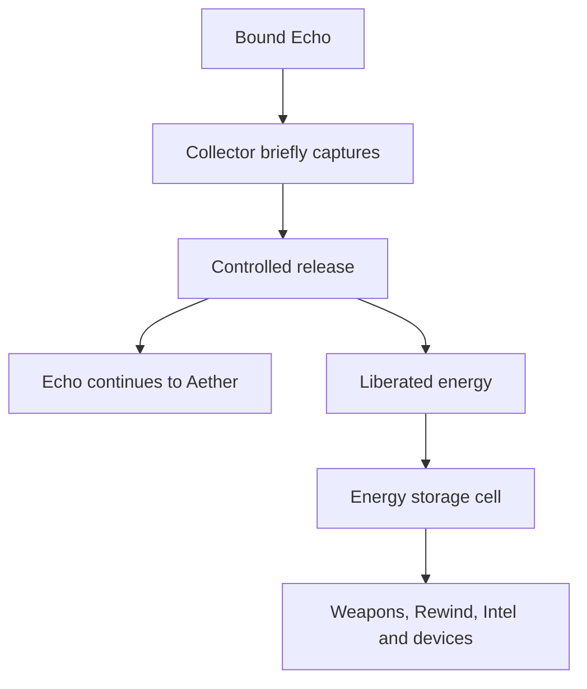

# Echo, release and Aether

**Version:** 2.0 | **Date:** 2026-11-27 | **Status:** Approved V2 direction; implementation details are working specifications

## Ontology
An Echo is the unspoken voice or remaining impression of a dead person. Aether is its metaphysical destination, not a planet. An Echo is not a battery, unit of currency, ammunition, or a resurrection token. Modern inhabitants have diverse beliefs about whether it retains awareness. The game does not settle that theological question.

| Condition | Meaning |
|---|---|
| Free Echo | Naturally moving toward Aether; a collectable one is temporarily bound to a local field |
| Bound Echo | Held by creature, material or equipment; may be released |
| Residual imprint | Non-conscious recorded memory pattern; can replay, cannot be collected as a person |
| Saturated field | Abnormally high concentration of Echoes; risks Warp |
| Lost Echo | Trapped by the failed Convergence network |
| Destroyed Echo | Directly consumed; permanently gone |

## Safe release cycle (creator correction)
Aster and Orion possess an Echo Collector with release chamber and energy-storage cell. On interaction with a bound Echo, or collection of an Echo liberated from a defeated creature, the device briefly captures it, immediately performs controlled release and stores the liberated **Echo Energy (EE)**. The Echo proceeds toward Aether; excess energy at full capacity dissipates safely. Collection never leaves a long-term stockpile of souls. Ordinary memory recordings and ambient decoration are not collectable. Interactables explicitly indicate whether a releasable Echo is present.

Voruun destructive consumption is a different path: bound/free Echo -> destruction -> energy for organism; no Aether passage from that Echo. Ordinary fauna may draw leaked energy or carry bound Echoes without destroying them. Golems store them due to failed containment. Dropped EE yield represents liberated energy, not a number of souls. See [playable resource rules](../04_GAME_SYSTEMS/RESOURCE_MANAGEMENT.md).

## Story demonstration
Town memorial shows release; Bram teaches the Collector on a safe sample; first Forager gives a second demonstration; Silent Gallery differentiates memories from Echoes; Reservoir contrasts dangerous accumulation with safe passage; Voruun traces and later direct consumption create stakes. Finale depicts mass release; never reveal what lies beyond Aether.
