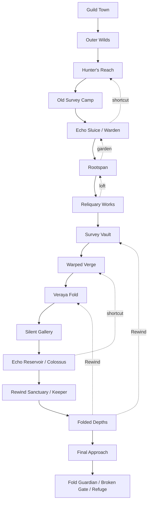

# Connected world map and progression graph

**Version:** 2.0 | **Date:** 2026-11-27 | **Status:** Approved V2 direction; implementation details are working specifications

The sanctuary spans Eldara and Veraya. The surface entrance is inaccessible after WARP; this is the only major irreversible geographic transition before the ending. Main topology is authored and persistent. The player map has historical and current layers, landmarks, barriers, rest nodes and shortcuts. Map scraps are optional; core clues auto-record. All links below are bidirectional when unlocked unless indicated; WARP closes the town link in both directions. Story event happens in HUN03, not at the town exit.

## Connection manifest
`—` means no gate. Flags are persisted and only set by the corresponding encounter/puzzle. `!WARP` means link is unavailable once the Warp happens. P09 is at REW04 after acquisition.

| Room A | Room B | Required flag(s) | Type |
|---|---|---|---|
| TOW01 | TOW02 | — | two-way |
| TOW02 | TOW03 | — | two-way |
| TOW03 | TOW04 | BRIEFED | two-way |
| OUT01 | OUT02 | — | two-way |
| OUT02 | OUT03 | FIRST_RELEASE | two-way |
| OUT02 | OUT04 | — | two-way |
| HUN01 | HUN02 | — | two-way |
| HUN02 | HUN03 | — | two-way |
| HUN02 | HUN04 | — | two-way |
| CAM01 | CAM02 | — | two-way |
| CAM02 | CAM03 | — | two-way |
| CAM02 | CAM04 | — | two-way |
| SLU01 | SLU02 | — | two-way |
| SLU02 | SLU03 | SLUICE_OPEN | two-way |
| SLU02 | SLU04 | — | two-way |
| ROT01 | ROT02 | — | two-way |
| ROT02 | ROT03 | — | two-way |
| ROT02 | ROT04 | WARDEN_DOWN | two-way |
| REL01 | REL02 | — | two-way |
| REL02 | REL03 | WORKS_POWER | two-way |
| REL02 | REL04 | — | two-way |
| SUR01 | SUR02 | — | two-way |
| SUR02 | SUR03 | ARCHIVE_ALIGNED | two-way |
| SUR02 | SUR04 | — | two-way |
| WAR01 | WAR02 | — | two-way |
| WAR02 | WAR03 | TOPOLOGY_ALIGNED | two-way |
| WAR02 | WAR04 | — | two-way |
| VER01 | VER02 | — | two-way |
| VER02 | VER03 | — | two-way |
| VER02 | VER04 | — | two-way |
| SIL01 | SIL02 | — | two-way |
| SIL02 | SIL03 | — | two-way |
| SIL02 | SIL04 | — | two-way |
| RES01 | RES02 | — | two-way |
| RES02 | RES03 | RESERVOIR_STABLE | two-way |
| RES02 | RES04 | — | two-way |
| REW01 | REW02 | KEEPER_EXPOSED | two-way |
| REW02 | REW03 | KEEPER_DOWN | two-way |
| REW03 | REW04 | REWIND_ACQUIRED | two-way |
| FOL01 | FOL02 | — | two-way |
| FOL02 | FOL03 | REWIND_TRAINED | two-way |
| FOL02 | FOL04 | REWIND_ACQUIRED | two-way |
| FIN01 | FIN02 | — | two-way |
| FIN02 | FIN03 | ANCHORS_STABLE | two-way |
| FIN02 | FIN04 | — | two-way |
| GAT01 | GAT02 | GUARDIAN_DOWN | two-way |
| GAT02 | GAT03 | GATE_DIAGNOSED | two-way |
| GAT03 | GAT04 | SIGNAL_SENT | two-way |
| TOW04 | OUT01 | TUTORIAL_DONE & !WARP | two-way |
| OUT03 | HUN01 | — | two-way |
| HUN03 | CAM01 | WARP | two-way |
| CAM03 | SLU01 | MAP_ALIGNED | two-way |
| SLU03 | ROT01 | WARDEN_DOWN | two-way |
| ROT03 | REL01 | — | two-way |
| REL03 | SUR01 | WORKS_POWER | two-way |
| SUR03 | WAR01 | VAULT_MAP | two-way |
| WAR03 | VER01 | TOPOLOGY_ALIGNED | two-way |
| VER03 | SIL01 | — | two-way |
| SIL03 | RES01 | MEMORIAL_SEEN | two-way |
| RES03 | REW01 | COLOSSUS_DOWN | two-way |
| REW04 | FOL01 | REWIND_TRAINED | two-way |
| FOL03 | FIN01 | FOLDS_ALIGNED | two-way |
| FIN03 | GAT01 | ANCHORS_STABLE | two-way |
| SLU04 | HUN02 | SLUICE_OPEN | shortcut |
| ROT03 | SLU02 | GARDEN_RESTORED | shortcut |
| RES04 | WAR02 | RESERVOIR_STABLE | shortcut |
| FOL01 | SUR04 | REWIND_TRAINED | shortcut |
| FOL02 | VER04 | REWIND_RETURN_OPEN | shortcut |
| REL04 | ROT02 | LOFT_RELAY | shortcut |
| WAR04 | VER02 | LOOP_MARKED | shortcut |

## Critical route and loops
TOW01→02→03→04→OUT01→02→03→HUN01→02→03→CAM01→02→03→SLU01→02→03→ROT01→02→03→REL01→02→03→SUR01→02→03→WAR01→02→03→VER01→02→03→SIL01→02→03→RES01→02→03→REW01→02→03→04→FOL01→02→03→FIN01→02→03→GAT01→02→03→04. Optional branches never supply critical flags. SLU04 opens return to HUN02 after P01; ROT03 water shortcut is optional; RES04 loop reveals geographic logic; FOL shortcuts reward Rewind mastery. No fast travel required; room transitions and shortcuts reduce backtracking. Map pins explain locked story routes but never claim the broken gate can be opened.
